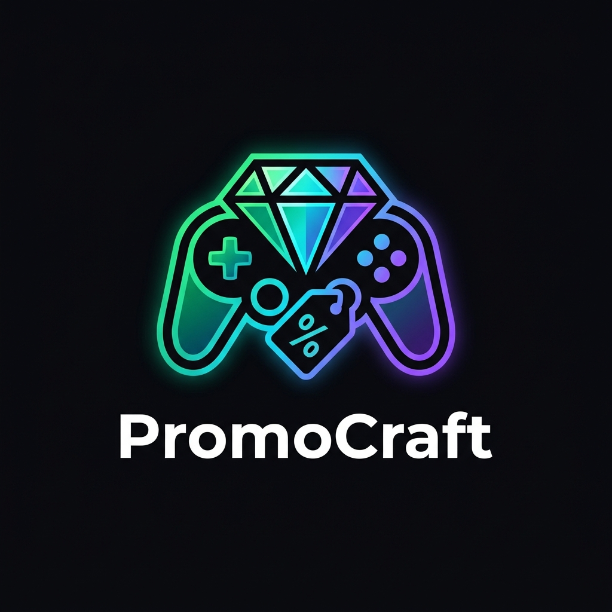
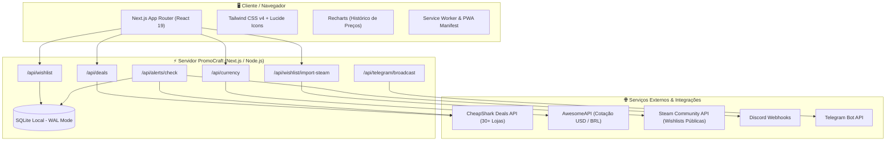

<p align="center">
  
</p>

<p align="center">
  <strong>Agregador e comparador em tempo real de promoções de jogos de PC com alertas de preço e conversão BRL.</strong>
</p>

<p align="center">
  <a href="https://promocraft.netlify.app"></a>
  <a href="https://nextjs.org"></a>
  <a href="https://www.typescriptlang.org"></a>
  <a href="https://tailwindcss.com"></a>
  <a href="./LICENSE"></a>
  <a href="https://github.com/Henrique1601/PromoCraft/actions"></a>
</p>

<p align="center">
  <a href="https://promocraft.netlify.app">🚀 Acessar Aplicação</a> •
  <a href="#-principais-recursos">⚡ Recursos</a> •
  <a href="#-arquitetura-do-sistema">📐 Arquitetura</a> •
  <a href="#-como-executar-localmente">🛠️ Execução Local</a> •
  <a href="#-variáveis-de-ambiente">🔑 Variáveis</a> •
  <a href="#-licença">📄 Licença</a>
</p>

---

## 📖 Sobre o Projeto

O **PromoCraft** é uma plataforma moderna desenvolvida para gamers de PC que desejam encontrar os melhores preços e promoções históricas em mais de 30 lojas digitais autorizadas (Steam, Epic Games Store, GOG, Nuuvem, Green Man Gaming, Fanatical, entre outras).

Além de consolidar os menores preços do mercado, o PromoCraft converte automaticamente os valores em dólar para **Reais (BRL)** com base na cotação comercial atualizada em tempo real, permite importar instantaneamente sua Lista de Desejos pública da Steam e enviar alertas automáticos diretamente para canais do **Discord** ou grupos/canais do **Telegram**.

---

## ⚡ Principais Recursos

- 🔥 **Feed Unificado de Ofertas**: Consulta consolidada de descontos em mais de 30 lojas parceiras oficiais.
- ⚖️ **Comparador Lado a Lado (`/game/[id]`)**: Tabela detalhada de preços em cada loja com redirecionamento direto aos links de ativação.
- 📉 **Histórico de Menor Preço & Gráficos**: Gráfico interativo exibindo a evolução de preços e o recorde histórico absoluto registrado.
- 💵 **Conversão BRL em Tempo Real**: Câmbio dinâmico USD ➔ BRL com cache inteligente em memória e tolerância a falhas.
- 🎁 **Filtro de Gratuidade (100% OFF)**: Acesso rápido a jogos gratuitos temporários e brindes (freebies/giveaways).
- ❤️ **Wishlist & Alertas Customizados**: Defina metas de valor desejadas e receba notificações automáticas quando o preço cair.
- 🤖 **Disparo para Discord & Telegram**: Notificação via Discord Webhooks e broadcast de ofertas via Telegram Bot.
- 🎮 **Importador Steam One-Click**: Importe sua Wishlist pública da Steam fornecendo apenas o SteamID64 ou URL de perfil.
- 📱 **Progressive Web App (PWA)**: Totalmente responsivo, instalável em dispositivos móveis e desktops com suporte offline básico.

---

## 📐 Arquitetura do Sistema



---

## 🛠️ Stack Tecnológica

| Camada | Tecnologia | Descrição |
|---|---|---|
| **Framework** | [Next.js 16](https://nextjs.org/) | App Router, Server Components e Edge Routes |
| **Linguagem** | [TypeScript 5](https://www.typescriptlang.org/) | Tipagem estrita de contratos de API e modelos |
| **Estilização** | [Tailwind CSS v4](https://tailwindcss.com/) | Design dark moderno com tokens esmeralda e neon |
| **Componentes** | [Lucide React](https://lucide.dev/) | Ícones vetoriais modernos |
| **Visualização** | [Recharts](https://recharts.org/) | Gráficos interativos de histórico de cotações |
| **Persistência** | [better-sqlite3](https://github.com/WiseLibs/better-sqlite3) | Banco relacional ultrarrápido com WAL Mode |
| **Deploy** | [Netlify](https://www.netlify.com/) | Integração contínua com `@netlify/plugin-nextjs` |

---

## 🚀 Como Executar Localmente

### Pré-requisitos
- **Node.js** v20.x ou superior
- **npm** ou **yarn** / **pnpm**

### Passo a Passo

1. **Clone o repositório:**
   ```bash
   git clone https://github.com/Henrique1601/PromoCraft.git
   cd PromoCraft
   ```

2. **Instale as dependências:**
   ```bash
   npm install
   ```

3. **Configure as variáveis de ambiente:**
   ```bash
   cp .env.example .env.local
   ```

4. **Inicie o servidor de desenvolvimento:**
   ```bash
   npm run dev
   ```

5. **Acesse no navegador:**
   ```
   http://localhost:3000
   ```

---

## 🔑 Variáveis de Ambiente

Crie um arquivo `.env.local` na raiz com base no exemplo abaixo:

| Variável | Obrigatória | Descrição | Exemplo |
|---|---|---|---|
| `TELEGRAM_BOT_TOKEN` | Não | Token do bot do Telegram gerado via BotFather | `123456789:ABCdefGhIJKlmNo...` |
| `TELEGRAM_CHAT_ID` | Não | Chat ID ou canal receptor de alertas | `@meucanalpromocraft` ou `-100...` |
| `NEXT_PUBLIC_APP_URL` | Não | URL pública para avatar e webhooks | `https://promocraft.netlify.app` |

---

## 🤝 Diretrizes de Contribuição & Conventional Commits

Contribuições são bem-vindas! Ao submeter commits e pull requests, siga a convenção de mensagens estruturadas:

- `feat:` Novas funcionalidades (ex: `feat(alerts): add webhook retry logic`)
- `fix:` Correção de bugs (ex: `fix(currency): handle offline rate fallback`)
- `refactor:` Refatoração sem mudança comportamental (ex: `refactor(db): optimize query indexes`)
- `docs:` Documentação e guias (ex: `docs: update installation instructions`)
- `test:` Inclusão ou ajuste de suítes de teste (ex: `test: add deals route integration tests`)
- `chore:` Tarefas de manutenção ou dependências (ex: `chore(deps): bump nextjs to 16.4.3`)

---

## 📄 Licença

Distribuído sob a licença **MIT**. Consulte o arquivo [LICENSE](./LICENSE) para obter mais informações.

<p align="center">
  Desenvolvido com ☕ e paixão por games por <strong>Henrique Bezerra Dos Santos</strong>.
</p>
